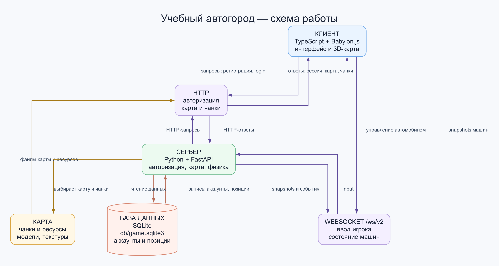

# Учебный автогород

Клиент: Babylon.js + TypeScript (`client/`). Сервер: FastAPI + Python (`server/`).
Сервер рассчитывает физику на 30 Гц и рассылает состояние всех машин на 20 Гц.
Клиент отправляет управление, интерполирует координаты и рисует седаны Kenney.

## Схема архитектуры



## Запуск

Сервер, из корня проекта, в первом терминале:

```sh
cd /Users/tagooc/game-hackaton
python3 -m venv .venv
source .venv/bin/activate
python -m pip install -r server/requirements.txt
python -m uvicorn server.app:app --host 0.0.0.0 --port 8000
```

Клиент, во втором терминале:

```sh
cd /Users/tagooc/game-hackaton/client
npm ci
npm run dev
```

С локальными сертификатами открыть `https://localhost:5179/`. Второй ноутбук
в той же сети открывает `https://<LAN-IP-сервера>:5179/`. Без сертификатов
Vite использует `http://`. Каждому игроку нужен отдельный аккаунт.
При повторном подключении одного аккаунта старое окно отключается с сообщением.
В Vite настроен прокси API и `/ws/v2` на порт 8000: cookie и все запросы идут
через адрес страницы. Порт клиента остаётся 5179.

### Локальный HTTPS для игры в LAN

Если в `client/certs/` присутствуют оба файла `lan-cert.pem` и `lan-key.pem`,
Vite автоматически запускается на HTTPS, а WebSocket через тот же адрес
использует WSS. Если хотя бы одного файла нет, сохраняется обычный HTTP-режим.
Команды запуска клиента и сервера при этом не меняются.

Для одноразовой настройки на компьютере, который запускает игру:

```sh
mkcert -install
mkcert -cert-file client/certs/lan-cert.pem \
  -key-file client/certs/lan-key.pem \
  192.168.1.74 localhost 127.0.0.1
```

Файл корневого сертификата, который покажет `mkcert -CAROOT`, нужно один раз
установить как доверенный на компьютерах всех игроков. Серверный `lan-key.pem`
передавать другим игрокам и добавлять в Git нельзя. После этого открывайте:
`https://192.168.1.74:5179/`.

Зарегистрируйтесь или войдите, дождитесь загрузки, нажмите на сцену.
W — газ, S — торможение и затем задний ход, A/D — руль, Space — тормоз.
Клик по сцене захватывает курсор, мышь — осмотр, Esc — освобождение и торможение.
Колесо мыши — приближение. При потере фокуса ввод
сбрасывается и отправляется тормоз; сервер также тормозит после 250 мс без ввода.

Для автономного запуска после установки зависимостей:

```sh
cd /Users/tagooc/game-hackaton/client
npm run build
cd ..
.venv/bin/python -m uvicorn server.app:app --host 0.0.0.0 --port 8000
```

После сборки и перезапуска сервер раздаёт игру на `http://<LAN-IP-сервера>:8000/`.
Ресурсы и библиотеки при игре загружаются локально, CDN не используется.

## Когда нужен перезапуск

При обычном запуске Python-сервера из инструкции выше изменения `.py` вступают
в силу после перезапуска: в его терминале нажмите `Ctrl+C` и снова выполните:

```sh
cd /Users/tagooc/game-hackaton
.venv/bin/python -m uvicorn server.app:app --host 0.0.0.0 --port 8000
```

Для разработки можно включить автоматический перезапуск при сохранении Python-кода.
Сначала остановите прежний сервер через `Ctrl+C`, затем запустите:

```sh
cd /Users/tagooc/game-hackaton
.venv/bin/python -m uvicorn server.app:app --host 0.0.0.0 --port 8000 --reload --reload-dir server
```

С `--reload` после изменения файлов `server/*.py` вручную перезапускать сервер
не нужно. Во время перезапуска соединения игроков прерываются; клиент
переподключается автоматически. Аккаунты и сохранённые позиции остаются в SQLite.
Для совместного тестирования без изменений кода используйте запуск без `--reload`.

| Что изменили | Что сделать |
| --- | --- |
| Python-код в `server/` | Перезапустить Python-сервер; с `--reload` это произойдёт автоматически. |
| TypeScript, JavaScript, CSS или HTML клиента при `npm run dev` | Vite обновляет страницу или модуль автоматически. Перезапуск Vite не нужен. Если состояние игры осталось прежним — обновить страницу. |
| GLB, текстуры или другие файлы в `client/public/` | Обновить страницу, чтобы игра заново загрузила ресурсы. Если изменились файлы, перечисленные в манифесте карты, пересобрать ассеты и манифест по инструкции в ROAD_MAP.md. |
| Схему карты, `manifest.json` или `navigation.json` | Выполнить генератор карты, перезапустить Python-сервер и обновить страницу. Сервер читает карту при запуске; `--reload --reload-dir server` изменения JSON карты не отслеживает. |
| `client/.env` или переменные окружения Vite | Перезапустить Vite. |
| `client/vite.config.ts` | Vite обычно перезапускается сам. Если этого не произошло — остановить через `Ctrl+C` и снова запустить. |
| Зависимости клиента (`package.json` / `package-lock.json`) | Остановить Vite, выполнить `npm --prefix client ci` из корня проекта и запустить Vite снова. |
| Зависимости Python (`server/requirements.txt`) | Остановить Python-сервер, выполнить `.venv/bin/python -m pip install -r server/requirements.txt` из корня проекта и запустить сервер снова. |
| Переменные окружения Python-сервера, например `GAME_DB_PATH` | Перезапустить Python-сервер с новым значением. |

Повторный запуск Vite, из его терминала после `Ctrl+C`:

```sh
cd /Users/tagooc/game-hackaton
npm --prefix client run dev
```

Порты остаются прежними: **8000 — Python**, **5179 — Vite**. Если порт занят,
сначала остановите уже запущенный процесс в его терминале.

При игре через собранную версию на порту **8000** Vite не используется.
После изменения клиента или его ресурсов выполните из корня проекта
`npm --prefix client run build` и обновите страницу. Если при запуске Python-сервера
папки `client/dist` ещё не было, после первой сборки перезапустите Python-сервер.
Изменения Python-кода требуют перезапуска независимо от сборки клиента.

## Авторизация и сеть

Регистрация и вход: `POST /api/v2/register`, `POST /api/v2/login`.
Проверка сессии: `GET /api/v2/me`; выход: `POST /api/v2/logout`.
HttpOnly-cookie `game_session` устанавливает сервер; пароли и токены не попадают
в localStorage. SQLite хранит аккаунты, хеши паролей, сессии и позицию машины.
Позиция сохраняется при отключении и штатной остановке сервера.
База по умолчанию `db/game.sqlite3`; путь переопределяется через `GAME_DB_PATH`.

Администратор закреплён за аккаунтом с username `ochov@gmail.com`; переменная
окружения `ADMIN_USERNAME` не используется. В меню выбора машины этому аккаунту
доступна панель «Настройки сервера». Он также может переключить погоду запросом
`POST /api/v2/admin/weather` с телом `{"weather":"clear|rain|fog|dark"}`.
Настройка действует для следующих сцен и хранится в памяти процесса сервера.

После HTTP-входа: bootstrap → `/ws/v2` → join → welcome → scene_prepare →
загрузка модели и текстуры → scene_ready → scene_start → snapshot/input.
До старта сцены ввод не отправляется и не применяется. Сервер проверяет оси,
seq, epoch и частоту сообщений. Старые snapshot и завершения загрузок игнорируются.
Полный snapshot создаёт появившиеся машины и удаляет отсутствующие.
После обрыва связи клиент подключается заново; коды 1008/4001 возвращают на вход.

Текущий контракт: [server/PROTOCOL.md](server/PROTOCOL.md). Сервер и клиент
используют только `/ws/v2`.

Карта и проверка подгрузки: [ROAD_MAP.md](client/src/world/ROAD_MAP.md).

## Текущие ограничения

- Один серверный процесс; запускать с одним worker.
- Карта из `blender/compact-reference.blend`: 111 дорожных модулей, подгрузка частями по 20 м.
  Машины появляются в одной точке на дороге; сначала отъедьте.
- Столкновения рассчитывает Python: ориентированные боксы кузовов и объектов,
  поднятые на 2,5 м невидимые боксы бордюров, опора на дорогу и гравитация.
  Под мостом сохраняется нижний уровень; падение не переносит машину на ближайший этаж.
- Нет сценариев ПДД, динамических светофоров и ИИ.
- Кэш ресурсов мира ограничен 10% уникальных опубликованных байтов мира.
  В счётчик входят дорога, здания, пропсы, машина со встроенной текстурой,
  манифест и резерв незавершённых загрузок. Это учёт размеров файлов контента,
  а не ограничение RAM/VRAM браузера или размера JavaScript.
  Подробнее: [карта](client/src/world/ROAD_MAP.md).
- Аккаунты, сессии и сохранённые позиции остаются после перезапуска;
  при аварийном завершении процесса последнее движение может не сохраниться.

## Спавн и возврат

Новые игроки появляются на дороге в точке `spawn` манифеста карты:
`x=58.5, z=40, y=0.1`, направление — вдоль дороги на юг (`heading=-π`).
Во время игры нажмите **R**, чтобы остановиться и вернуться туда.
В сценариях возврат запрещён сервером. Перед продолжением движения клиент
дожидается загрузки области спавна. При обычном повторном входе сохраняется
последняя позиция игрока.

Длина своей и чужих машин — 3,3 м. Модель, бокс столкновений и колёсная база
уменьшены согласованно на 25%.

## Окружение

### Два NPC в общем мире

Сервер создаёт ровно две машины (`server/npc_traffic.py`). У каждой простой
замкнутый граф из четырёх узлов с закруглёнными правыми поворотами:

- Северное кольцо: `(-60, 20) → (-60, 50) → (-30, 50) → (-30, 20) → начало`.
- Южное кольцо: `(-60, -70) → (-60, -40) → (-30, -40) → (-30, -70) → начало`.

Это оси дорог; траектория смещена на 1,7 м вправо, скорость до 3 м/с
(около 11 км/ч). Маршруты не пересекаются и обходят зоны сбора сценариев.
Перед игроками NPC тормозят, учитывая прогноз пересечения пути, и продолжают
движение после освобождения дороги. Объезда и обгона нет: при блокировке ждут.
После пяти секунд ожидания над NPC появляется «Пропустите, пожалуйста»;
сообщение исчезает, когда он продолжает движение.
Хитбоксы совпадают с обычной машиной (3,3 × 1,95 м) и участвуют в серверной
физике; игрок может столкнуться с NPC. Состояние NPC общее для всех клиентов.
Они не являются аккаунтами, не занимают места в очередях и не появляются
в отдельных сценах сценариев. Используется существующая модель автомобиля.

Ветка `environment`: тёплый направленный свет сверху, мягкие тени 2048² вокруг
игрока и линейный туман от 40 до 60 м. Область подгрузки расширена до 80 м,
чтобы граница появления объектов оставалась за туманом даже при удалении камеры.

Из локального пользовательского набора LowPoly City добавлены 8 зданий,
81 дерево, 12 лавок и 15 площадок кварталов. Геометрия размещена по
`blender/compact-city.blend`; экспорт исправляет лавки на вертикальную посадку
ножками на землю. Общие прототипы используют thin instances; фасады сохраняются
целиком, несколько зданий повторяют одну модель. Текстуры окружения запечены
в цвета вершин. Модели и чанки загружаются и освобождаются одним загрузчиком.
